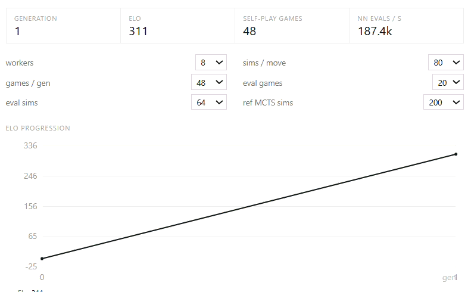

# AlphaZero for Connect Four, in the browser

> MCTS self-play across web workers · hand-written neural net · live Elo progression · zero ML dependencies

**az4** trains an AlphaZero-style agent for Connect Four entirely in your browser. no pretrained
weights, no TensorFlow, no server. Press **start self-play** and watch a randomly-initialized
network learn to play, then play against any generation while it trains. The whole app compiles to
a single static HTML file (~250 kB).



## Highlights

- **From scratch** — the MLP (84→128→128, dual policy/value head, ~28k params), its backprop, and
  AdamW are ~200 lines of plain TypeScript. No ML libraries anywhere.
- **PUCT MCTS** — the learned agent uses neural-network-guided search, not rollouts.
  Dirichlet(α=1.0, ε=0.25) noise at the root during self-play.
- **Distributed self-play** — a pool of Web Workers (up to `min(8, cores − 2)`) plays games and
  evaluation matches in parallel; a separate trainer worker owns the 60k-sample replay buffer; a
  third worker keeps the UI opponent responsive while training runs.
- **Honest Elo** — every generation plays rated matches against the previous generation and the one
  from 4 gens back; its rating is the maximum-likelihood fit with opponents' ratings frozen.
  Gen 0 (random weights) = 0. Pure-rollout MCTS and a random player are tracked as outside
  baselines, so rating drift is visible rather than hidden.
- **Analysis UI** — play any checkpoint, and inspect per-column policy priors **P**, visit counts
  **N** and action values **Q** for every AI search, plus an eval bar from your perspective.
- **One file** — `vite-plugin-singlefile` inlines everything (workers included) into
  `dist/index.html`. Serve it from anywhere.

## Quick start

```bash
npm install
npm run dev     # hack on it
npm run build   # emits single-file dist/index.html
```

Open the app, press **start self-play**. On 6–8 cores a default generation
(48 games × 80 sims/move) takes a few seconds; the Elo curve starts climbing within minutes.

## How it works

### Position → network
The board is encoded canonically (from the side-to-move's view) as two 6×7 planes —
own stones | opponent stones — flattened to 84 inputs. An MLP `84 → 128 → 128` feeds a softmax
policy head (7 columns) and a `tanh` value head. Inference skips multiplication over unset cells.

### Search (PUCT)
At each node, pick the column maximizing

```
Q(s,a) + c · P(s,a) · √N(s) / (1 + N(s,a))      c = 1.5
```

Leaf evaluation comes from the value head — **no random rollouts in the learned agent**.
Visit counts at the root (temperature 1 for the first 10 plies, then greedy) become both the move
and the training target π.

### The loop (per generation)

```
                 ┌────────────────────────────┐
   weights ────► │ self-play worker pool       │  48 games × 80 sims
                 │ (1 … min(8, cores−2))       │  (s, π, z) + mirrored copies
                 └─────────────┬───────────────┘
                               ▼
                    trainer worker · 60k ring buffer
                    AdamW: CE(p, π) + (z − v)², ≤300 steps × batch 128
                               ▼
                 eval matches on the worker pool
                 vs gen n−1 · vs gen n−5 · vs pure-MCTS · vs random
                               ▼
              MLE Elo fit → history → new weights to all workers
```

### Elo
Gen 0 is a random net anchored at 0. Each new generation plays the previous one and gen n−5;
its rating maximizes the likelihood of those match outcomes with opponents' ratings treated as
fixed (plus a 1-draw prior against the anchor to keep early ratings finite). The pure-rollout
MCTS reference (10 games @ 200 sims) and a random player give fixed, un-anchored calibration points.

## Layout

```
src/engine/game.ts            rules, canonical encoding
src/engine/nn.ts              forward/backward + AdamW (no deps)
src/engine/mcts.ts            PUCT, rollout reference, self-play, matches
src/engine/selfplay.worker.ts self-play / match / analysis job runner
src/engine/trainer.worker.ts  replay buffer + minibatch SGD
src/engine/coordinator.ts     worker pool, generation loop, Elo, persistence
src/components/               board, charts, play and train panels
```

## Tuning (in the UI)

| setting        | default | notes                                |
|----------------|---------|--------------------------------------|
| workers        | min(8, hw−2) | self-play/eval parallelism        |
| sims / move    | 80      | 25 trains faster but noisier         |
| games / gen    | 48      | more games = stabler π targets       |
| eval games     | 20      | vs previous generation               |
| eval sims      | 64      | match search budget                  |
| ref MCTS sims  | 200     | strength of the outside baseline     |

## Honest limits

- Only the **latest** checkpoint persists (localStorage); the replay buffer and older generations
  are volatile. Use **export weights** to save a model.
- A ~28k-param MLP caps out well below perfect play — Connect Four is solved; this project is about
  the learning machinery, not the ceiling.
- Elo is chain-relative; the fixed MCTS baseline is there to expose any long-run drift.

## License

MIT
